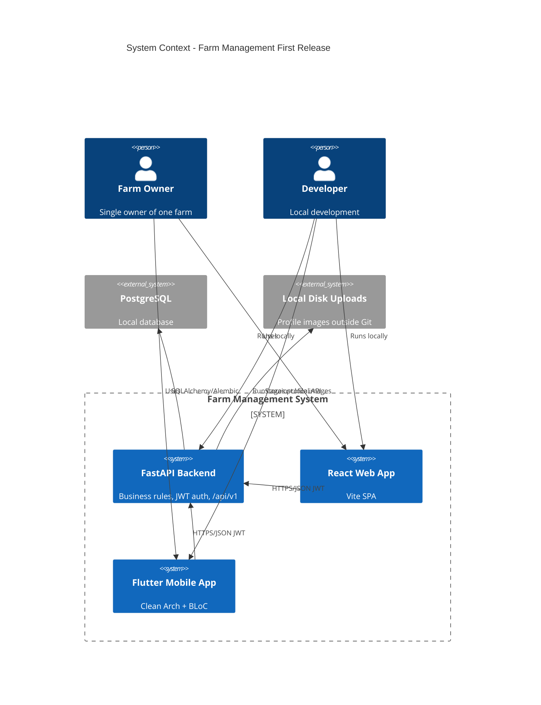

# Farm Management First Release - System Context

## System Overview

A single-owner farm management product: one FastAPI backend (modular monolith), one React (Vite) web client, and one Flutter mobile client. The owner authenticates and manages livestock, crops, inventory, and money records for a single farm. Business rules live in the API; clients present UI and call `/api/v1`.

## Actors

- **Farm Owner** (Human): Sole end user; signs up/in; manages profile, farm settings, and all farm records via web and/or mobile
- **Developer** (Human): Runs FastAPI, React, PostgreSQL, and Flutter locally without Docker during development

## External Systems

- **PostgreSQL** (Outbound persistence): System of record for owner and farm data — local install
- **Local filesystem** (Outbound uploads): Profile images under a documented path outside Git
- **No third-party auth, email, payments, or cloud hosting** in this intent

## Data Flows

### Inbound
- Owner credentials and profile/farm settings (JSON + multipart image)
- Livestock, crop, inventory, and income/expense records (JSON)
- JWT bearer tokens on private requests

### Outbound
- JSON resources and list pages (`items` + `meta`)
- Consistent error bodies (`code`, `message`, `details?`)
- JWT access + refresh tokens on auth success
- Served or referenced profile image files from local upload storage

## Context Diagram

## High-Level Constraints

- One farm, one owner; no staff/roles
- Local development without Docker; hosting TBD
- Vertical slices: auth/settings → cows → poultry → crops → inventory → income/expenses; each slice API then web then mobile
- Document API contracts before wiring client screens
- Shared tokens + Material 3; mobile Bangla + English

## Key NFR Goals

- Owner-only private data; JWT with short access TTL and refresh rotation
- Password ≥8 chars with letter+number; hashed only
- Currency default BDT (editable); suggested units; no FX
- Consistent error codes across React and Flutter
- Local CRUD p95 targets per requirements
