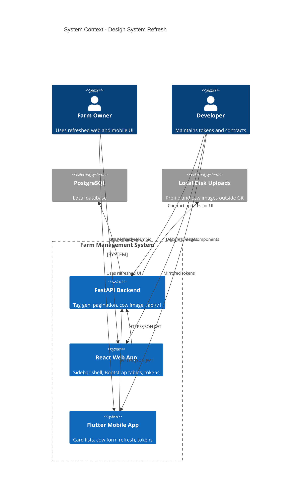

# Design System Refresh - System Context

## System Overview

A brown-field visual/UX refresh of the existing Farm Management System (FastAPI + React web + Flutter mobile). The same actors and persistence boundaries as first release remain; this intent changes presentation (web shell, tables, mobile cards, tokens) and extends the API only where the new UI requires it (auto tag numbers, cow images, paginated milk/feeding lists).

## Actors

- **Farm Owner** (Human): Uses refreshed web and mobile UIs to navigate and manage farm records
- **Developer** (Human): Maintains shared design tokens/components and API contracts across clients

## External Systems

- **PostgreSQL** (Outbound persistence): Existing system of record; may store new cow image metadata / tag generation results
- **Local filesystem** (Outbound uploads): Profile images today; may also store cow images under a documented path outside Git
- **No new third-party design CDN, auth, or notification services** in this intent (notification icon is UI chrome / placeholder)

## Data Flows

### Inbound

- Owner JWT on private requests (unchanged)
- Cow create/update payloads without manual tag (API generates tag); optional cow image multipart/upload
- Milk and feeding list requests with pagination (`limit=10` default page size)

### Outbound

- JSON resources including generated `tag_number`, optional cow image URL/path
- Paginated milk/feeding lists (`items` + `meta`)
- Served profile (and cow) images from local upload storage when authorized

## Context Diagram

## High-Level Constraints

- Builds on `001-farm-management-first-release`; no new farm domains
- Web: left sidebar `#2f6a3a` / white text; header + footer; Bootstrap tables for milk (and aligned feeding)
- Mobile: card list presentation
- Notification icon is placeholder until a notification data source is defined
- Prefer shared tokens where practical; web and mobile layouts need not be identical

## Key NFR Goals

- Shell usable; primary nav ≤ 2 clicks from menubar
- Page size 10 for milk/feeding without full-history download
- Auth-protected private images
- No blocking regressions on first-release happy paths
