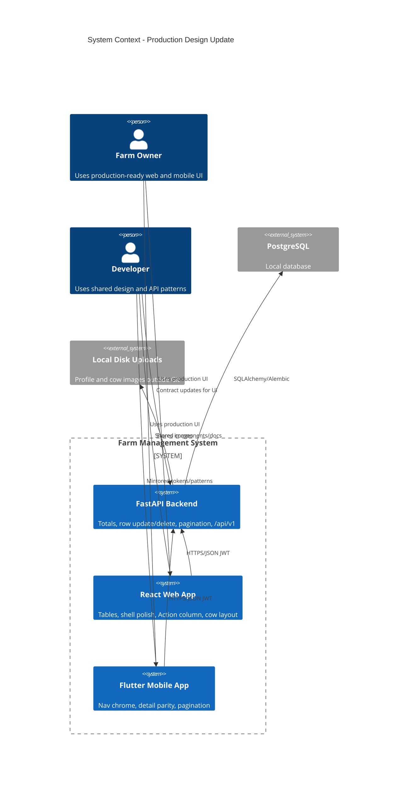

# Update API, Web, and Mobile Design - System Context

## System Overview

A brown-field production-readiness redesign of the existing Farm Management System (FastAPI + React web + Flutter mobile). Same actors and domain boundaries as intents `001` and `002`; this intent upgrades presentation (universal paginated tables, shell polish, mobile nav, cow detail layout, Edit/Archive/Action UX) and extends the API only where required (row totals, update/delete for table rows, pagination metadata).

## Actors

- **Farm Owner** (Human): Uses production-ready web and mobile UIs to manage farm records without design blockers
- **Developer** (Human): Integrates and extends shared layout, table, state, and API patterns

## External Systems

- **PostgreSQL** (Outbound persistence): System of record; may store feeding cost/total fields and support update/delete of sub-records
- **Local filesystem** (Outbound uploads): Profile and cow images under documented paths outside Git
- **No new third-party services** in this intent (notification icon remains UI chrome / placeholder unless separately specified)

## Data Flows

### Inbound

- Owner JWT on private requests (unchanged)
- Paginated list/history requests with `limit=10` (default) and `offset` (or equivalent)
- Update/delete payloads for tabular sub-records (at minimum cow milk and feeding)
- Existing cow create/update with image and auto tag (from intent `002`)

### Outbound

- JSON list responses with `items` + `meta` (total, limit, offset)
- Row fields sufficient to display **Total** (returned or unambiguously computable)
- Update/delete responses for Action-column operations
- Served cow/profile images when authorized

## Context Diagram

## High-Level Constraints

- Builds on `001-farm-management-first-release` and `002-design-system-refresh`
- No new farm domains; API changes only for design needs
- Web: universal Milk-style paginated tables; Action Edit/Delete; remove Back links; cow image left / info right
- Mobile: production nav; detail/history parity; pagination; equivalent edit/delete affordances
- Default page size **10**

## Key NFR Goals

- Farm owner completes core tasks on web and mobile without design blockers
- Developers extend UI via shared primitives
- No blocking regressions on auth and five domain happy paths
