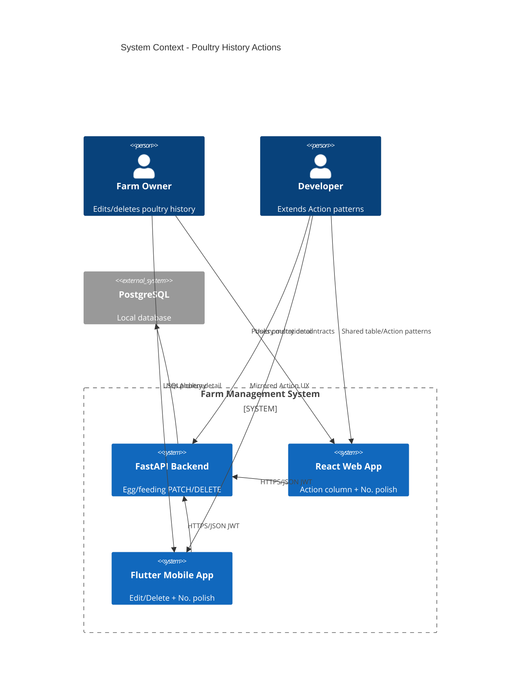

# Poultry History Actions and Table Polish - System Context

## System Overview

Brown-field extension of the Farm Management System: add **update/delete** for poultry egg and feeding sub-records, wire **Action** columns on web/mobile poultry histories, and polish history tables (`#` → **No.**, Edit primary / Delete danger) across clients. Same actors and stack as intents `001`–`003`.

## Actors

- **Farm Owner** (Human): Adds, edits, and deletes egg and feeding rows on web and mobile
- **Developer** (Human): Reuses 003 Action/table patterns with new poultry mutation contracts

## External Systems

- **PostgreSQL** (Outbound): Persist egg/feeding rows; hard-delete on DELETE
- **No new third-party services**

## Data Flows

### Inbound

- Owner JWT on private requests
- PATCH payloads for egg production and poultry feeding fields
- DELETE for egg/feeding row ids under a poultry group
- Existing POST/list for add and pagination

### Outbound

- Updated egg/feeding JSON resources
- `204` on successful hard-delete
- List pages unchanged in shape (`items` + `meta`)

## Context Diagram

## High-Level Constraints

- Extends sealed intent `003` (FR-13 to poultry); does not reopen full redesign
- Hard-delete only
- `#` → **No.** on all history tables (web + mobile)
- Edit primary / Delete danger on Action controls

## Key NFR Goals

- Farm owner completes add/edit/delete of one egg and one feeding on web and mobile without blockers
- Poultry mutation authz/archive parity with cow milk/feeding
