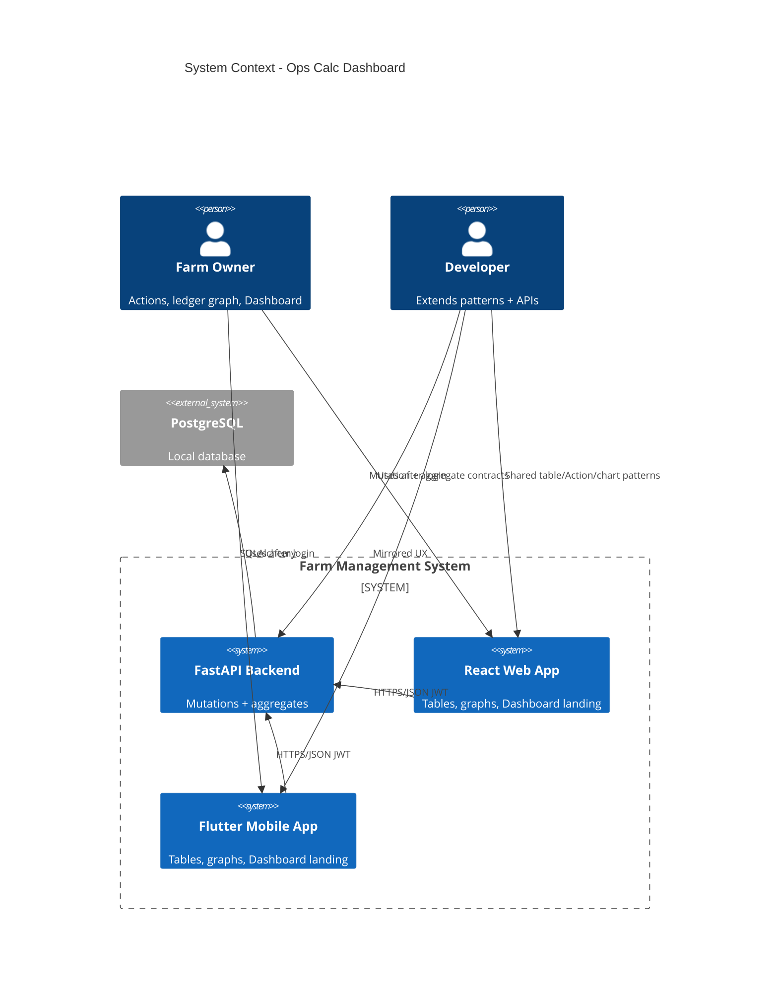

# Resolve Operations and Calculations Issue - System Context

## System Overview

Brown-field extension of the Farm Management System: crop expense/harvest **Action** (edit/delete), fertilizer-category stock history as a cow-like table, ledger date-range **numeric totals + graph**, and a post-login **Dashboard** with production and money graphs (day/week/month/year; default this week; no future dates in farm local TZ). Same actors and stack as intents `001`–`004`. API changes only as needed.

## Actors

- **Farm Owner / Farmer** (Human): Maintains crop and inventory history; views ledger totals/graphs; uses Dashboard after login on web and mobile
- **Developer** (Human): Extends Action/table/aggregate patterns; implements owner-scoped APIs

## External Systems

- **PostgreSQL** (Outbound): Persist crop expenses/harvests, inventory stock updates, ledger entries, cows/poultry production; hard-delete on DELETE
- **No new third-party chart SaaS** — charts render in React/Flutter clients from API JSON

## Data Flows

### Inbound

- Owner JWT on private requests
- PATCH/DELETE for crop expenses and harvests (and stock updates if Action is in scope)
- List/filter queries for fertilizer-category stock changes
- Ledger date-range queries for totals and series points
- Dashboard period queries (day/week/month/year) with bounds in farm local TZ
- Existing auth/sign-in (landing redirect is client-side)

### Outbound

- Updated crop expense/harvest (and stock) JSON resources; `204` on hard-delete
- Paginated fertilizer stock-change tables (`items` + `meta` where applicable)
- Period totals + series for ledger graph
- Dashboard aggregate series (egg, hen headcount, milk, cow production, expenses/cost, income)
- `4xx` when end bound is after “today” in farm local TZ

## Context Diagram

## High-Level Constraints

- Extends sealed intents `001`–`004`; does not reopen wholesale redesign
- Hard-delete only for history mutations
- Edit primary / Delete danger on Action controls
- Fertilizer scope = all stock changes for **fertilizer category** items
- Ledger keeps numeric totals **and** graph
- Dashboard default period = **this week**; future dates blocked in **farm local TZ**

## Key NFR Goals

- Farmer completes crop expense/harvest edit/delete on web and mobile
- Fertilizer-category stock table usable like cow history
- Ledger apply-range shows numbers + graph
- Post-login Dashboard with six series areas; period controls safe against future dates
